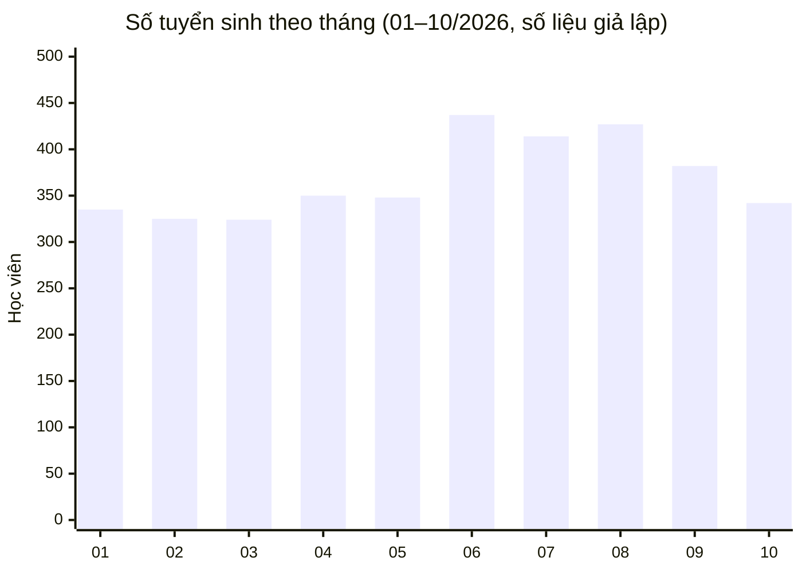

# Báo cáo tuyển sinh mô phỏng — Scenario 06 (Ticket #13)

Tệp bàn giao cho Director trong [scenario-06-deadline.md](../scenario-06-deadline.md). **Toàn bộ số liệu là giả lập**: không lấy từ CRM thật, không có danh tính học viên/phụ huynh, chỉ có số tổng hợp.

Trong tình huống, báo cáo được gửi dưới dạng 1 file Excel `Bao_cao_tuyen_sinh_2026-01_den_2026-10.xlsx` gồm 2 sheet. Trong repo, mỗi sheet được lưu thành 1 file CSV để xem trực tiếp trên GitHub:

| Sheet       | File                                   | Gửi ở mốc                                                    |
| ----------- | -------------------------------------- | ------------------------------------------------------------ |
| Chi tiết    | [s06-chi-tiet.csv](s06-chi-tiet.csv)   | Bản nháp 15:00 04/11 (email 5.5), giữ nguyên trong bản chốt   |
| Tổng hợp    | [s06-tong-hop.csv](s06-tong-hop.csv)   | Thêm vào bản chốt 17:00 04/11 (email 5.6) theo góp ý của Director |

## Định nghĩa và giới hạn dữ liệu

- **Tuyển sinh** = học viên đã đóng học phí, tính theo ngày đóng phí.
- Khoảng thời gian: 01/01/2026 – 31/10/2026.
- Phạm vi: 3 cơ sở × 2 chương trình × 4 khoá học × 10 tháng = 120 dòng chi tiết.
- Cơ sở Hải Châu (ĐN) tháng 09: CRM thiếu dữ liệu do lỗi đồng bộ, số liệu lấy từ admin cơ sở (phương án A, email 5.4). Cột *Nguồn dữ liệu* ghi rõ 4 dòng này.
- Không bao gồm: danh tính học viên/phụ huynh, doanh thu, tỷ lệ hoàn thành (nice-to-have, làm sau cuộc họp nếu cần).

## Tổng hợp (bản chốt)

| Cơ sở                  | Số tuyển sinh |
| ---------------------- | ------------: |
| Nguyễn Chí Thanh (HN)  | 1.380         |
| Cộng Hòa (HCM)         | 1.561         |
| Hải Châu (ĐN)          | 743           |
| **Tổng**               | **3.684**     |

| Chương trình | Số tuyển sinh |
| ------------ | ------------: |
| Coding Kid   | 1.610         |
| Coding Teen  | 2.074         |

### Biểu đồ theo tháng

